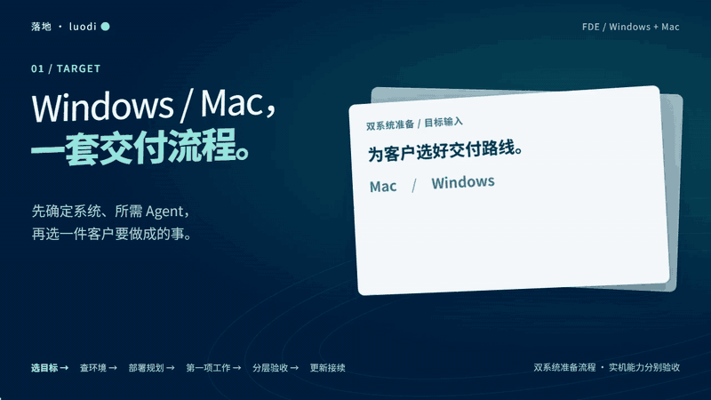

# Luodi · Agent Setup and Delivery

**Turn a new computer into a place where an Agent can do useful work.**

[中文](README.md) · [Interactive guide (Chinese)](docs/getting-started.html) · [Installation checklist](docs/installation-checklist.md) · [Isolated validation](docs/installation-verification.json)

Download the HTML and open it locally to use its checklist and copy controls. · Local validation build for FDEs

The intended workflow starts with a new Mac or Windows computer: select the Agent, check the environment and dependencies, review the deployment plan, configure the runtime and Skills, then validate one concrete customer task. Keep custom settings when adding or updating Skills, and leave a record that the next conversation can continue.

Current execution covers the Windows project-local example package, updates/recovery, and read-only target routing. Mac execution, dependency installation, and real Agent installation and Skill loading remain unimplemented.



[Local player](docs/watch.html) · [Chinese MP4](assets/readme/hero-zh.mp4?raw=true) · [WebP](assets/readme/hero-zh.webp?raw=true) · [Transcript and evidence scope](docs/demo.md)

The film illustrates the intended workflow. Its meeting-notes-to-action-list example is an authored synthetic illustration, not a successful run through a deployed Agent. The previous English film is excluded from the current release; this revision renders Chinese only.

## Start with the customer task

Open this project in Codex and use [.agents/skills/luodi/SKILL.md](.agents/skills/luodi/SKILL.md).

> Prepare an Agent on this customer's new computer. First identify Mac or Windows and whether you are already on the target. Check the environment and dependencies. The first task is turning meeting notes into actions with owners and due dates. Show the plan and missing capabilities before changes, then verify installation, loading, and task outcome separately.

If the executor is already on the target, use it locally without enabling SSH. For another computer, verify explicitly authorized existing access or report that access is missing. The current tool does not connect remotely.

```powershell
python -B client_setup.py configure --customer sample --brief examples/computer-local.json
```

Use `examples/computer-mac.json` for the Mac branch. `--brief` only emits guidance; it never installs, connects, or becomes an installation when approved. See the [support matrix](docs/support-matrix.md).

## Run the implemented foundation

On Windows with Python 3.12+, no extra Python dependencies are required:

```powershell
python -B demo.py
```

The isolated demo exercises pinned package installation, replay, update, preserved overrides, interruption recovery and receipts. Real Agent loading remains `not_verified`.

Only three user entries remain: configure, check and update. Review the exact instance and file plan before approving its `plan_id`. Keep public defaults, customer overrides and machine differences separate; start the next conversation by checking the saved receipt.

[First-task illustration](examples/first-task/action-list.md) · [Current executable workflow](docs/workflow.md) · [Validation](docs/validation.md) · [Source/license status](THIRD_PARTY_NOTICES.md)

No real dependencies or Agent runtime have been installed by this revision. No system proxy, TUN, firewall, SSH, credentials or persistent access are configured. Private repository delivery is authorized; public open-source publication remains pending the author's license and copyright decision.
