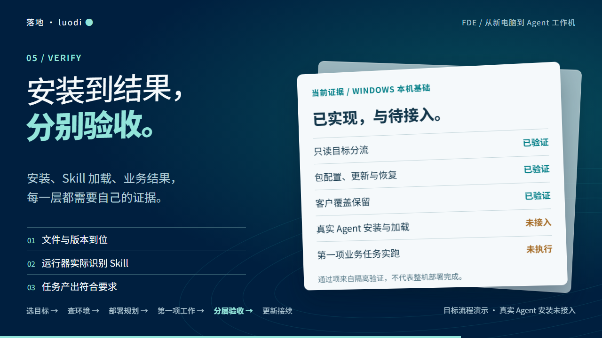

# 落地 · eric-agent-luodi-skill

**给客户交付 Agent，把目标、配置、验收和交接一起做好。**

[English](README.en.md) · 面向 FDE、实施顾问和负责客户交付的工程师 · [Apache-2.0](LICENSE)

[开始使用](#三步开始) · [交付清单](docs/installation-checklist.md) · [24 秒介绍](docs/watch.html) · [能力范围](docs/support-matrix.md)

客户说“帮团队用上 AI”，你要先弄清楚它要完成哪件事、在哪台电脑上运行、谁来验收。落地把这些判断串成一份交付清单：复用已有环境，保留客户定制，用具体成果验收，给下一位接手的人留下继续工作的入口。

<picture>
  <source media="(prefers-reduced-motion: reduce)" srcset="assets/readme/hero-zh.png">
  
</picture>

[中文 MP4](assets/readme/hero-zh.mp4?raw=true) · [GIF](assets/readme/hero-zh.gif) · [轻量 WebP](assets/readme/hero-zh.webp) · [文字稿](docs/demo.md)。短片保留「落地 · luodi」中文品牌，画面使用原创示例。

## 适合你现在的哪件事

| 你正在做 | 交给落地 | 拿到什么 |
|---|---|---|
| 第一次给客户准备 Agent | “先把这次交付计划列清楚” | 目标、系统与工具选择、逐步完成条件 |
| 接手别人做了一半的项目 | “先检查做到哪里，从下一步继续” | 当前证据、缺口、下一项具体动作 |
| 增加规则或 Skill | “看差异，保留客户原来的选择” | 变更范围、验收办法、恢复与接续记录 |

## 三步开始

**1. 在你自己的 Codex 中安装 Skill。** 把这段话复制给它：

```text
帮我安装这个 Skill：
https://github.com/NewenergyEric/eric-agent-luodi-skill/tree/main/.agents/skills/eric-agent-luodi-skill
审阅来源后安装完整 Skill 目录；如果已有旧版，先核对差异，不覆盖我的工作记录。
```

**2. 告诉它这次交付要做成什么。** 不清楚的部分可以直接说“不确定”。

```text
$eric-agent-luodi-skill 我要为一个客户准备 Mac，默认 OpenClaw。
第一件任务：把会议纪要整理成带负责人和期限的行动清单。
先给我交付计划、每一步的完成条件和需要客户参与的地方。
保留现有环境与客户定制，先做规划。
```

**3. 从当前一步往下走。** Agent 只补问影响当前步骤的信息；你核对计划，再按具体授权推进。以后直接说“检查上次进度”或“更新一个 Skill，保留原配置”。

只安装 Skill 就能开始整理目标、交付计划和验收清单；无需先下载 HTML。Windows / Mac 都有准备流程。当前仓库运行器执行 Windows 项目内的合成配置包；真实客户机器安装与连接的范围见[支持矩阵](docs/support-matrix.md)。

<details>
<summary>已有旧版，或使用其他 Agent</summary>

旧 Skill 名称是 `luodi`，新名称是 `eric-agent-luodi-skill`。先确认新版已安装且能被选中，再请 Agent 仅移除确认属于本项目的旧 Skill；客户目录、实例和回执不随更名迁移。若技能列表未刷新，在下一轮对话重新选择。

其他支持 Agent Skills 的工具可按其官方方式安装完整 Skill 目录。提供终端或文件能力的工具才能执行相应检查；普通聊天可用来整理清单。执行本仓库示例需要完整仓库和 Windows + Python 3.12+。

</details>

## 开始后会怎样

下面是使用示例，展示交付过程中的分工：

> **你：** 客户有一台 Mac，想把会议纪要整理成行动清单。
>
> **落地：** 交付目标是“每条行动都有负责人、期限，缺失信息单独列出”。先确定这次是在目标 Mac 上工作，还是由另一台电脑协助；然后核对已有工具，给出配置与验收计划。
>
> **你：** 先规划，别改客户的现有设置。
>
> **落地：** 先输出准备清单、规则差异和验收样例，保留客户需要确认的选择。后续执行按范围和证据逐项接续。

## 一张清单，做到可以交接

- [ ] **定目标：** 写清第一件任务、输入、输出和验收人。
- [ ] **备环境：** 按 Windows / Mac 与所选 Agent 检查依赖和网络，复用可用工具。
- [ ] **选工具：** Codex / IDE 按需选择，日常 Agent 默认 OpenClaw，也可用 Hermes。
- [ ] **配规则：** 合并 AGENTS.md 等工作规则，保留客户选择；个人记忆和秘密留在原处。
- [ ] **加 Skills：** 先选第一件任务需要的少量技能，核对来源、版本、权限和加载。
- [ ] **看成果：** 分别核对安装、实际加载和任务结果。
- [ ] **留交接：** 记录版本、证据、未完成项、恢复办法和下次从哪里继续。

[完整文字清单](docs/installation-checklist.md) · [可选 HTML 清单](docs/getting-started.html) · [行为规则示例](examples/behavior/AGENTS.template.md)

## 用一件工作验收

[会议纪要示例](examples/first-task/meeting-notes.md) → [行动清单示例](examples/first-task/action-list.md)：检查每条行动是否可执行，有没有负责人、期限，缺失信息是否被明确指出。成果确认后，再核对客户能否自己继续使用。



<details>
<summary>开发者：运行示例、验证和继续扩展</summary>

在 Windows + Python 3.12+ 的完整项目根目录运行，无需额外 Python 依赖：

```powershell
python -B demo.py
```

示例在新的独立目录演练配置包安装、重跑、升级、保留覆盖和中断恢复。入口仍为 `configure / check / update`，具体用法见[工作流](docs/workflow.md)。Mac / 另一台电脑的 `--brief` 生成只读计划。

```powershell
python -B -m unittest discover -s tests -v
python -B tools/release.py check
```

[执行范围](docs/support-matrix.md) · [示例安装记录](docs/installation-verification.json) · [独立 Skill 检查](docs/skill-install-verification.json) · [验证方法](docs/validation.md) · [视频重建](motion/README.md)

</details>

[Skill 与写法来源](docs/skill-usage.md) · [发布规则](docs/publishing.md) · [安全说明](docs/security.md) · [第三方许可](THIRD_PARTY_NOTICES.md)
